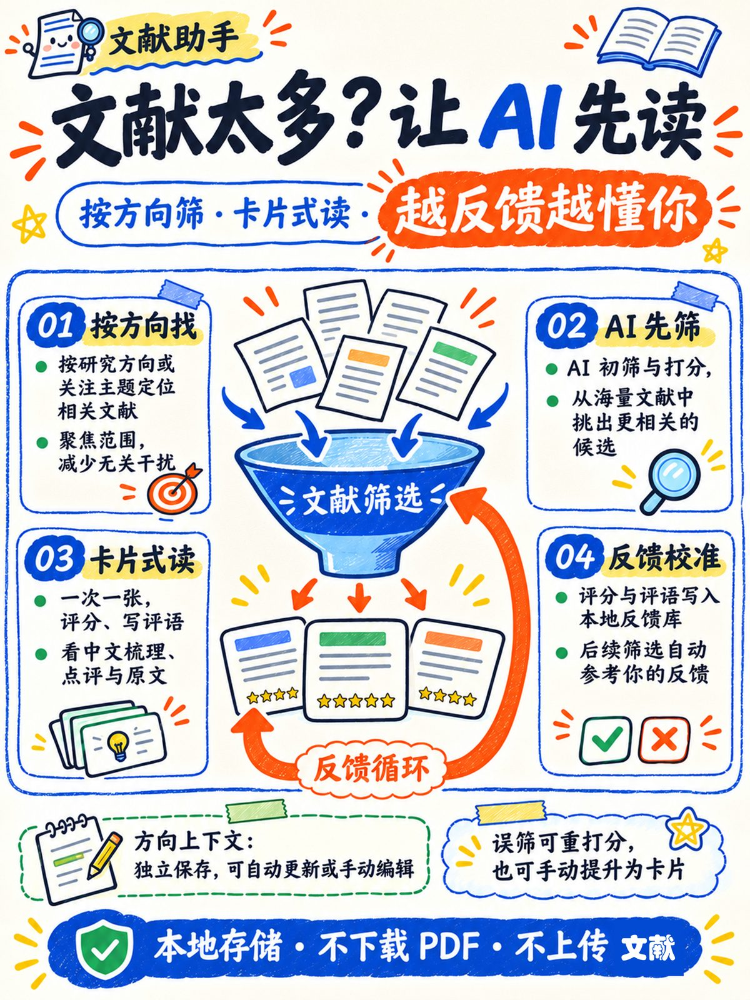
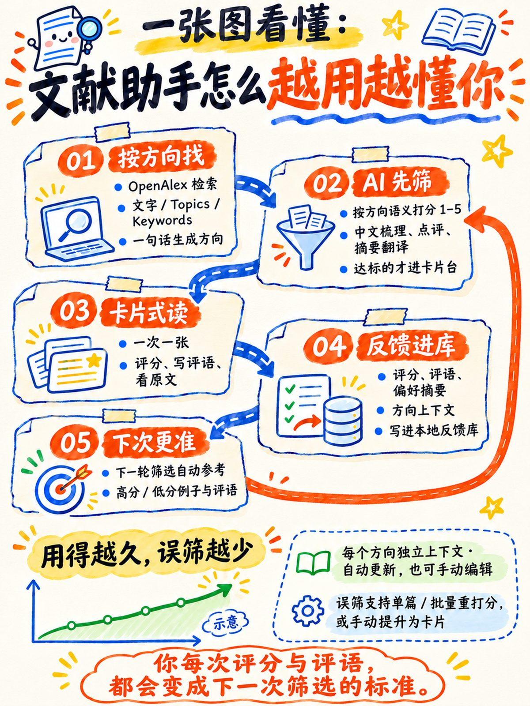
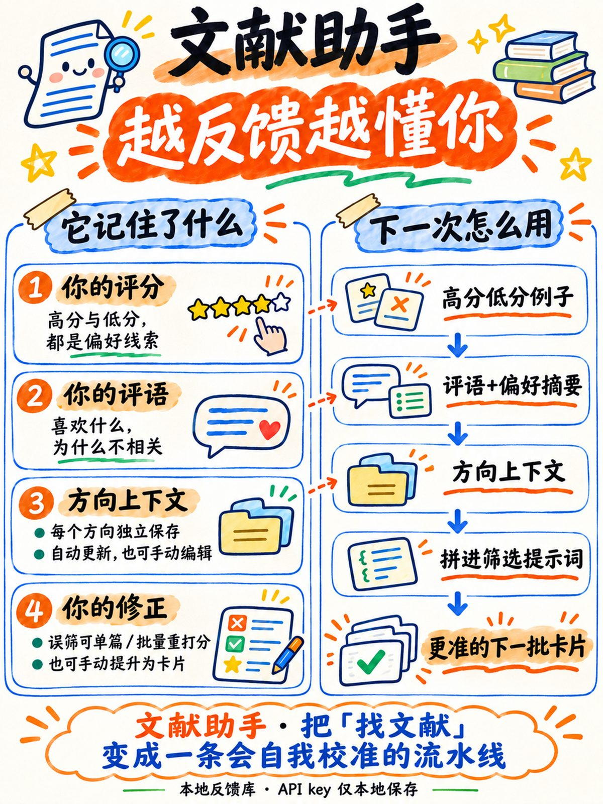

# dsh-paper-agent · 文献助手

给 DeepSeek Harness 装一个「会越用越懂你」的文献工作台：**按方向拉论文 → AI 打分筛选 → 卡片式精读 → 你的反馈反过来校准下一次筛选**。

> **越反馈越懂你，推荐文献越准确。**
> 每一次评分、每一句评语都会进入本地反馈库，用来调整之后每次 AI 筛选的口径。



## 它解决什么

每天新论文太多，真正相关的没几篇。文献助手把「找、筛、读、评」收进一个页面：

- **按研究方向找**：OpenAlex 检索，文字 / Topics / Keywords 三种方式，一句话就能生成方向；
- **AI 先帮你筛**：模型按方向语义打分，生成中文标题、内容梳理、点评和摘要翻译，只把达标的送进卡片台；
- **卡片式精读**：一次一张，评分、写评语、看原文，读完自动消失；
- **反馈闭环**：高分/低分例子、评语、偏好摘要、方向上下文会持续更新，筛选越用越贴近你的口味。

## 反馈是怎么起作用的

1. **即时校准**：每次筛选自动带上你最近的高分/低分例子、评语和偏好摘要；
2. **方向上下文学习**：每个方向有一段会进入提示词的「方向上下文」，该方向新增反馈 ≥3 条自动刷新，也可以手动编辑；
3. **可纠错**：误筛的文献能单篇/批量重新打分，或手动提升为可看卡片；
4. **可控制**：模型、推理强度、筛选门槛、点评人设都能在设置里改；不想用反馈就一键关闭。

## 界面预览

 

## 安装

需要 DeepSeek Harness 0.2.x 桌面版。

```bash
# 从 GitHub（公开仓库）
dsh plugin --profile desktop add github:StressState/dsh-paper-agent

# 或者本地目录 / tarball
dsh plugin --profile desktop add /absolute/path/to/dsh-paper-agent
```

安装后**重启 DSH**，左侧栏会出现「文献助手」。

## 第一次使用

1. 打开「文献拉取」，设置里填工作区路径（例如 `D:\Papers`）；
2. 配 OpenAlex key：填邮箱 →「申请并保存」→ 邮箱点激活链接 → 回来刷新（也可直接粘贴已有 key）；
3. 「一键配置方向」：用一句话描述你的方向，选检索方式，点自动配置；
4. 测试拉取 → 拉取；
5. 「一键筛选」选篇数，等进度完成；到「文献卡片台」开始读。

## 数据与隐私

- 所有数据只在本机工作区 `<workspace>/.paper-agent/`：方向、文献库、筛选结果、你的评分与评语、偏好摘要；
- API key 只存在本机 `settings.json`，不写进插件包、不上传；
- 插件不下载 PDF、不访问论文网页；插件包本身不含任何本机路径或密钥。

## 常见问题

- **提示「本地数据通道未启动」**：确认已安装并重启 DSH；仍不行检查 43117–43126 端口占用。
- **一键筛选提示没有模型**：去 DSH「设置 → Models」选一个默认模型。
- **拉取没新增**：这个时间窗之前拉过了；已入库论文只更新 `lastSeen`。
- **额度**：免费 key 每天 10,000 请求，UTC 午夜重置；拉取窗口按月对齐。

## 开发与自检

```bash
npm test   # 离线自检：渲染、数据服务、本地通道、假模型 AI 链路
```

零第三方运行时依赖，只使用 Node 内置模块；要求 Node ≥ 20。

## 反馈与共建

欢迎测评使用、提 Issue、一起改进：https://github.com/StressState/dsh-paper-agent/issues

如果你也在做文献筛选/推送，欢迎交流你的工作流和痛点。

## 许可

MIT
